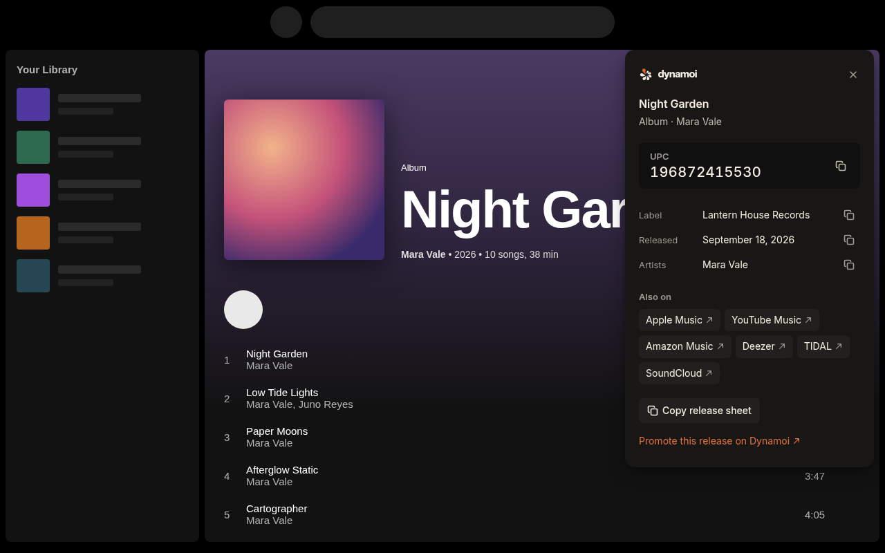

# Dynamoi for Chrome

**A free Dynamoi tool for artists: see the data behind any song on Spotify.**

Open an album or track on [open.spotify.com](https://open.spotify.com) and a
small Dynamoi card shows its release details: the UPC or ISRC, label, release
date and credited artists, plus links to other stores when Dynamoi finds them,
and "Not available" when a code can't be confirmed. Use it to
check your own release metadata or research comparable releases. No account
needed, nothing to set up.

  

## What it does

- **Release card.** On album and track pages, the card shows the UPC (albums)
  or ISRC (tracks), label, release date and credited artists, each with a copy
  button. Links to the release on other stores appear when Dynamoi finds them.
- **More detail.** Tracks add length, explicit, producers, playlist count and
  a Sound section (BPM, key with Camelot code, energy, danceability,
  positivity). Albums add track count, P line and distributor. An artist
  section shows the lead artist's monthly listeners, country, genres and top
  cities.
- **Copy release sheet.** One click copies every field as plain text, ready
  for a distributor ticket or a pitch.
- **Look up anything.** Paste a Spotify link, UPC or ISRC into the toolbar
  popup. Your last 20 lookups stay on your device.
- **Keyboard first.** `Alt+Shift+D` shows or hides the card; `Esc` closes it.

## Install

Add it from the [Chrome Web Store](https://chromewebstore.google.com/detail/dynamoi/abagmakkbloofbpnbldkaolinegeklhf),
then open any album or track on open.spotify.com.

## Privacy

- No sign-in and no tracking. The extension does not collect or sell data.
- It reads only the Spotify ID in the page address of the album or track you
  open (or the code you paste) and asks `dynamoi.com` for that release's data.
- It needs only the `storage` permission, for your on-device lookup history,
  and access to `open.spotify.com` and `dynamoi.com`.

## Grow the music you research

Dynamoi is a music promotion platform that works with any distributor. The
Dynamoi team runs Instagram and Facebook ads optimized for Spotify listeners
and YouTube campaigns on Google, and Smart Links and analytics are free. See
[dynamoi.com](https://dynamoi.com).

## Source

This repository mirrors the extension's source from the Dynamoi monorepo,
where it is built with WXT and React. Read the code, and report bugs in
[issues](https://github.com/getDynamoi/browser-extension/issues).

MIT licensed. See [LICENSE](./LICENSE).

---

**Part of Dynamoi** · [MCP server](https://github.com/getDynamoi/dynamoi) · [CLI](https://github.com/getDynamoi/dynamoi/tree/main/cli) · [Agent plugins](https://github.com/getDynamoi/agent-plugins) · [Homebrew tap](https://github.com/getDynamoi/homebrew-tap) · [Chrome extension](https://github.com/getDynamoi/browser-extension) · [dynamoi.com](https://dynamoi.com) · [Docs](https://dynamoi.com/docs) · [Support](https://dynamoi.com/support)
